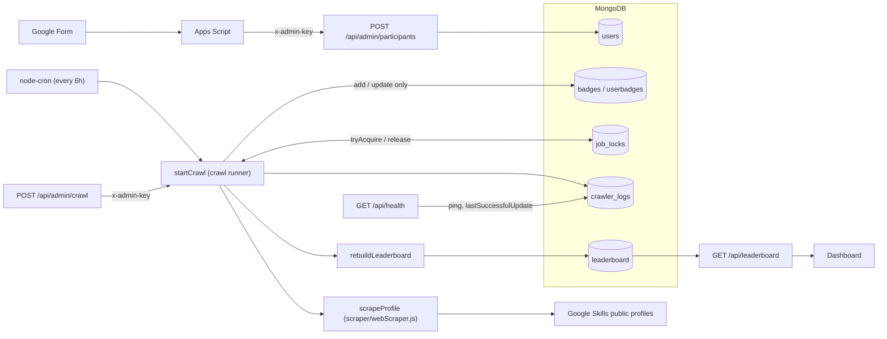
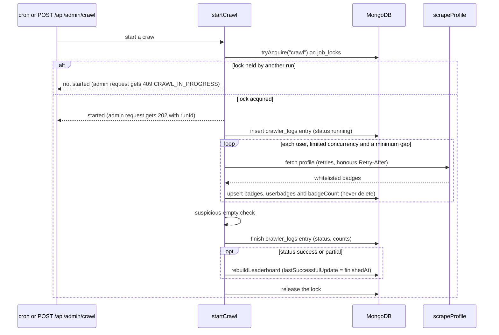

# Google-Skills-Leaderboard

Backend for the GDG MIT Google Skills competition leaderboard. Participants register through a Google Form. Every 6 hours the server reads each participant's public Google Skills profile, stores the competition badges they have earned, and rebuilds a ranked leaderboard. The leaderboard is served over a small REST API, together with admin endpoints for ingestion and manual crawls.

The server lives in `server/` (Node.js, Express, MongoDB).

## Architecture





Guarantees:
- A failed, empty or interrupted scrape writes nothing for that user. Nothing in the crawl path ever deletes users, badges or userbadges.
- Only one crawl runs at a time. Cron, `POST /api/admin/crawl` and `npm run crawl:once` all go through the same MongoDB lock, which a heartbeat keeps alive and the database clock expires.
- A run where (almost) every scrape comes back empty is marked `failed` (`suspicious_empty_run`). That pattern is what a block, CAPTCHA or markup change looks like.
- The public API reads a precomputed snapshot. A failed run leaves the last good leaderboard and its `lastSuccessfulUpdate` in place.
- `npm run check:real` and `crawl:once --dry-run` are read-only: no writes, no lock, no collections created.
- Public responses never include emails. Admin routes need the API key and are rate limited before the key is checked.

## Setup

Requires Node.js 22 or newer, and MongoDB 4.2 or newer (Atlas or self-hosted).

```bash
cd server
npm install
cp .env.example .env    # set MONGO_URI and ADMIN_API_KEY
npm test                # in-memory MongoDB, no network access
npm start               # runs index.js; `npm run dev` restarts on changes
```

The process always runs in UTC: `config/timezone.js` sets `TZ=UTC` before anything parses a date, and startup fails if that didn't take effect.

Other commands (from `server/`):

| Command | Purpose |
|---|---|
| `npm run crawl:once` | One crawl through the lock. Exits 2 if another crawl is running. |
| `npm run crawl:once -- --dry-run` | Scrape and report without writing anything. |
| `npm run check:real` | Read-only check against a real database (see below). |

## Testing

From `server/`:

```bash
npm test            # unit and integration tests (about 30 s)
npm run test:e2e    # end-to-end tests (about 1-2 min)
```

The unit and integration tests run against an in-memory MongoDB and inject a fake scrape function.

The end-to-end tests start the real server (`index.js`) as a separate process against an in-memory MongoDB replica set. A preloaded module (`tests/e2e/helpers/fakeGoogle.js`) replaces Google Skills with fake public profiles, which can show normal pages, sign-in walls, 404s, 500s, 429s with `Retry-After`, and malformed dates.

No test ever contacts the real Google site: outbound network access is blocked during the end-to-end tests.

## Configuration

Every variable is validated at startup, and an invalid value stops the process. `server/.env` is loaded if it exists; set `ENV_FILE` to load another file, or leave `ENV_FILE` empty to load none.

| Variable | Default | Notes |
|---|---|---|
| `MONGO_URI` | required | `mongodb://…` or `mongodb+srv://…` |
| `ADMIN_API_KEY` | required | at least 32 characters, sent as the `x-admin-key` header |
| `NODE_ENV` | `development` | `development`, `production` or `test` |
| `PORT` | `3000` | |
| `LOG_LEVEL` | `info` | pino log level |
| `MONGO_SERVER_SELECTION_TIMEOUT_MS` | `10000` | startup fails fast if MongoDB is unreachable |
| `CORS_ORIGINS` | empty | comma-separated allowed origins; empty allows any origin |
| `TRUST_PROXY` | `1` | reverse-proxy hops in front of the app, used to find client IPs |
| `RATE_LIMIT_PUBLIC_PER_MIN` | `120` | per IP, `/api/leaderboard` |
| `RATE_LIMIT_ADMIN_PER_MIN` | `30` | per IP, `/api/admin/*` |
| `COMPETITION_START_DATE` | `2026-10-26` | inclusive, UTC |
| `COMPETITION_END_DATE` | unset | optional, inclusive |
| `CRON_ENABLED` | `true` | `.env.example` sets `false` |
| `CRON_SCHEDULE` | `0 */6 * * *` | node-cron expression |
| `CRON_TIMEZONE` | `Asia/Kolkata` | applies to the schedule only |
| `STALE_AFTER_HOURS` | `13` | `/api/health` reports `degraded` after this long without a successful crawl |
| `CRAWL_CONCURRENCY` | `3` | profiles fetched in parallel |
| `CRAWL_MIN_GAP_MS` | `500` | minimum gap between request starts |
| `CRAWL_MAX_RETRIES` | `3` | network errors, 429 and 5xx only |
| `CRAWL_BACKOFF_BASE_MS` / `CRAWL_BACKOFF_MAX_MS` | `1000` / `30000` | exponential backoff with full jitter |
| `CRAWL_RETRY_AFTER_MAX_MS` | `120000` | cap on a `Retry-After` wait, which pauses all workers |
| `LOCK_TTL_MS` | `120000` | crawl lock lease, renewed every third of it |
| `SUSPICIOUS_EMPTY_MIN_USERS` | `5` | smallest run checked for mass-empty results |
| `SUSPICIOUS_EMPTY_RATIO` | `0.3` | share of previously scoring users coming back empty that fails a run |

## Scoring

A badge counts when all of these hold:
- It is one of the 10 skill badges in `server/data/Accepted Badges.csv`:
  - The Basics of Google Cloud Compute
  - Configure Service Accounts and IAM Roles for Google Cloud
  - Implement Speech and Language Solutions with Pre-trained APIs
  - Develop AI-Powered Prototypes in Google AI Studio
  - Analyze Images with the Cloud Vision API
  - Build a Website on Google Cloud
  - Create Your First Gemini Enterprise Application
  - Store, Process, and Manage Data on Google Cloud - Console
  - Using the Google Cloud Speech API
  - Explore Generative AI in Agent Platform
- The date shown on the profile is on or after 2026-10-26.
- Each badge name counts once per participant.

Badges with no readable date are skipped.

**Ranking:**
- More valid badges ranks higher.
- On equal counts, whoever earned their latest counted badge earlier ranks higher.
- Only participants with the same count and the same date share a rank (1, 1, 3). Within a shared rank, participants are listed by username.
- Participants with no valid badges share the last rank.

## API

Errors always have the shape `{ "error": { "code", "message", "details"?, "requestId" } }`. Public responses never contain email addresses.

### Public

`GET /api/leaderboard?page=1&limit=50&search=`
- `limit` is 1–100.
- `search` matches usernames case-insensitively as plain text.
- Ranks stay global when paging or searching.
- Responses are cacheable for 30 s.

```json
{
  "lastSuccessfulUpdate": "2026-10-29T14:53:21.363Z",
  "competitionStartDate": "2026-10-26T00:00:00.000Z",
  "pagination": { "page": 1, "limit": 50, "total": 3, "totalPages": 1 },
  "rows": [
    {
      "rank": 1,
      "userId": "6ae35de0fb18de8bf02bda9a",
      "username": "Asha Rao",
      "skillsUrl": "https://www.skills.google/public_profiles/a1b2c3",
      "validBadgeCount": 2,
      "latestValidBadgeAt": "2026-10-28T00:00:00.000Z",
      "badges": [
        { "name": "Build a Website on Google Cloud", "imageUrl": "https://cdn.qwiklabs.com/638.png", "earnedAt": "2026-10-27T00:00:00.000Z" },
        { "name": "The Basics of Google Cloud Compute", "imageUrl": "https://cdn.qwiklabs.com/754.png", "earnedAt": "2026-10-28T00:00:00.000Z" }
      ]
    }
  ]
}
```

Before any snapshot exists, `rows` is empty and `lastSuccessfulUpdate` is `null`.

`GET /api/leaderboard/:userId` returns one row in the same shape. A malformed id returns 400 `VALIDATION_ERROR`, and an unknown id 404 `NOT_FOUND`.

`GET /api/health` is not rate limited and is never cached.
- `ok`: MongoDB answers and the last successful crawl is recent.
- `degraded`: no successful crawl yet, or the last one is older than `STALE_AFTER_HOURS`.
- `down` (503): the database ping failed.

```json
{
  "status": "ok",
  "db": { "ok": true, "latencyMs": 1 },
  "lastSuccessfulUpdate": "2026-10-29T14:53:21.363Z",
  "crawl": { "inProgress": false, "lock": { "held": false, "acquiredAt": null, "expiresAt": null, "meta": null } },
  "latestRun": { "runId": "792049a2-…", "status": "success", "startedAt": "2026-10-29T14:53:21.218Z", "finishedAt": "2026-10-29T14:53:21.363Z" },
  "cron": { "enabled": true, "schedule": "0 */6 * * *", "timezone": "Asia/Kolkata" }
}
```

`GET /api/health/live` returns `{ "status": "ok" }` without touching the database.

### Admin

All admin routes need the header `x-admin-key: <ADMIN_API_KEY>`. A missing or wrong key returns 401 `UNAUTHORIZED`, and too many requests return 429 `RATE_LIMITED`.

`POST /api/admin/crawl` starts a crawl in the background: `202 { "runId": "792049a2-…" }`. If a crawl is already running it returns:

```json
{ "error": { "code": "CRAWL_IN_PROGRESS", "message": "A crawl is already running", "details": { "trigger": "cron", "since": "2026-10-29T12:00:00.112Z" }, "requestId": "…" } }
```

`GET /api/admin/crawl/status` returns the lock, the latest run and `lastSuccessfulUpdate`:

```json
{
  "lock": { "held": false, "acquiredAt": null, "expiresAt": null, "meta": null },
  "latestRun": {
    "runId": "792049a2-…", "trigger": "manual", "triggeredBy": "admin", "status": "success",
    "startedAt": "2026-10-29T14:53:21.218Z", "finishedAt": "2026-10-29T14:53:21.363Z", "durationMs": 145,
    "counts": { "total": 3, "succeeded": 3, "failed": 0, "empty": 0, "badgesUpserted": 3, "badgesSkippedNoDate": 0 },
    "failures": []
  },
  "lastSuccessfulUpdate": "2026-10-29T14:53:21.363Z"
}
```

A run's `status` is one of:
- `running`
- `success`
- `partial`: some users failed, including a participant with valid badges whose profile came back empty (`empty_result`; their data is kept)
- `failed`: nobody succeeded, the run crashed or was interrupted by a restart, or `suspicious_empty_run`
- `aborted`: the lock was lost or the server shut down

Each entry in `failures` is `{ userId, reason, httpStatus }`, where `reason` is `http_<status>`, `empty_result`, `badge_conflict`, or a network error code.

`GET /api/admin/crawl/logs?limit=20` returns `{ "runs": [ … ] }`, newest first, without the `failures` arrays.

`POST /api/admin/participants` adds or updates participants. The body is one row, an array of rows, or `{ "participants": [ … ] }`, with 1–500 rows:

```json
{ "username": "Ben Lee", "email": "ben@example.com", "skillsEmail": "ben.skills@example.com", "profileUrl": "http://cloudskillsboost.google/public_profiles/d4e5f6/" }
```

```json
{ "received": 1, "inserted": 1, "updated": 0, "duplicatesInBatch": 0, "rejected": [] }
```

Profile URLs:
- They are stored as `https://www.skills.google/public_profiles/<id>`.
- Also accepted: `http`, no `www`, the `cloudskillsboost.google` host, a trailing slash, and a query string.
- Anything else is rejected as `invalid_profile_url`.

Matching:
- A submission matches an existing participant by profile id, ignoring case, and updates only that participant's name and emails.
- Badges, `badgeCount` and `credits` are never touched.
- An email that belongs to another participant rejects the row as `email_in_use_by_other_profile`. Other invalid rows are rejected as `invalid_row`.

Errors and side effects:
- If every row is rejected, the response is 422 `ALL_ROWS_REJECTED`.
- After any insert or update, the leaderboard is rebuilt, so new participants appear with 0 badges.

## Google Form setup

`docs/google-form-apps-script.gs` sends each new form response to `POST /api/admin/participants`.

1. Open the form's response spreadsheet, choose Extensions → Apps Script, and paste the file.
2. Under Project Settings → Script Properties, add:
   - `INGEST_URL` = `https://<host>/api/admin/participants`
   - `ADMIN_API_KEY` = the server's key
3. Under Triggers, add a trigger for `onFormSubmit`: event source "From spreadsheet", event type "On form submit". Authorize the script when asked.
4. To import responses that already exist, run `syncAllRows()` once from the editor. It sends them in batches of 500 and is safe to re-run.

The script reads the columns "Your Full Name", "Email address", "Confirm your email address linked to your Google Skills Profile" and "Google Skills Public Profile URL". It retries network errors, 429 and 5xx responses with backoff, and never logs the key or email addresses.

## Real-data check

`npm run check:real` tests the crawler against a real database without changing it. It needs `server/.env` with `MONGO_URI` and `ADMIN_API_KEY`.

It is read-only:
- it runs a dry-run crawl;
- it takes no lock and writes no `crawler_logs`;
- it creates no indexes or collections.

It is therefore safe to run while a real crawl is in progress.

It prints:
- valid badge counts per participant (by username), and totals;
- failures grouped by reason;
- accepted badges dated the day before the competition started, which don't count;
- the raw "Earned …" texts from one profile, which show the date format and timezone profiles use;
- whether the unique indexes that block duplicates exist (users: email, skillsEmail, skillsUrl; userbadges: user + badge). It reads them with `listIndexes` only. A missing one prints a WARNING: duplicate protection is off, usually because the collection already holds duplicate values, so the server's index build failed.

The run makes about one request per participant every 0.5 s, three at a time, and ends with "No data was written."

## Go-live checklist

1. Run `npm run check:real` against the live database and share the full output.
2. Review the output:
   - per-participant counts look right;
   - `empty_result` failures are rare;
   - there are no `http_403` or `http_429` failures;
   - dates parse;
   - all four unique indexes show `ok` (no WARNING);
   - few or no badges are dated 2026-10-25.
3. Back up the live database: `mongodump --uri "$MONGO_URI" --out backup-YYYYMMDD`.
4. Start the server with `CRON_ENABLED=false` and trigger one crawl:
   ```bash
   curl -X POST -H "x-admin-key: $ADMIN_API_KEY" https://<host>/api/admin/crawl
   curl -H "x-admin-key: $ADMIN_API_KEY" https://<host>/api/admin/crawl/status
   ```
   Repeat the status call until the latest run is no longer `running`.
5. Check `GET /api/leaderboard` (ranks, counts, `lastSuccessfulUpdate`) and `GET /api/health` (`"status": "ok"`).
6. Set `CRON_ENABLED=true` and restart. Check `/api/health` again after the next scheduled run.

## Operating notes

- **Never run `server/seeds/userSeed.js` against the live database.** It deletes every user before importing. It was only for the initial import.
- **The dashboard must read the REST API (`/api/leaderboard`), not MongoDB.** Only the API applies the full counting rules.
- **Take a `mongodump` backup** before any manual data change or risky deployment.
- **Run a single instance.** Rate limiting and leaderboard rebuild ordering are in-process; the crawl lock is in MongoDB.
- **Shutdown is graceful.** On SIGTERM or SIGINT the server:
  1. stops accepting connections;
  2. stops cron;
  3. aborts a running crawl, then waits up to 20 s for it to record `aborted` and release the lock;
  4. closes the database connection.
- **Accepted risk:** `xlsx` 0.18.5 has known advisories. It only reads the committed badge CSV and the organisers' local seed file, never uploaded files.
